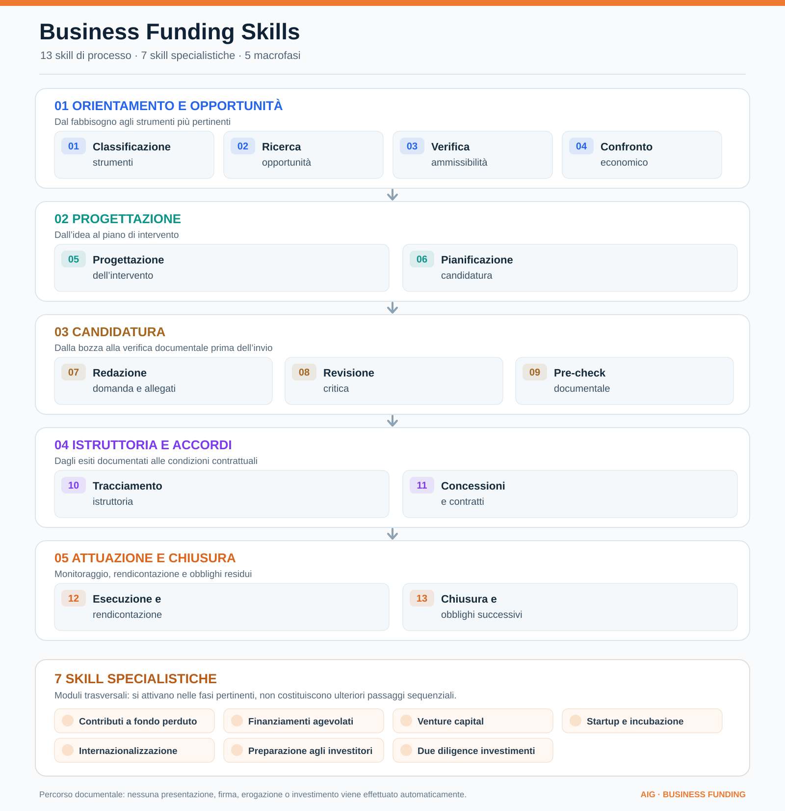

# Business Funding Skills

Skill indipendenti per individuare e valutare **agevolazioni e strumenti di sostegno alle imprese** in Italia e in Europa. Progetto complementare a [EU Funding Skills](https://github.com/aigconsulting/eu-funding-skills): non replica la gerarchia UE, la progettazione Horizon o le verifiche delle call.


## Skill disponibili



[Apri il diagramma vettoriale SVG](assets/business-funding-lifecycle.svg)

| Macrofase | Passaggi | Risultato documentale |
| --- | --- | --- |
| **1. Orientamento e opportunità** | Classificazione → ricerca → ammissibilità → confronto economico | Individuazione degli strumenti pertinenti e analisi preliminare |
| **2. Progettazione** | Disegno dell'intervento → pianificazione | Progetto e piano di candidatura documentati |
| **3. Candidatura** | Redazione → revisione → pre-check | Bozza e controlli documentali prima dell'invio |
| **4. Istruttoria e accordi** | Tracciamento → concessioni e contratti | Evidenze degli esiti e condizioni della formalizzazione |
| **5. Attuazione e chiusura** | Esecuzione/rendicontazione → chiusura | Evidenze di avanzamento, saldo e obblighi residui |

Le fasi costituiscono un percorso **analitico e documentale**, non un processo eseguito automaticamente. Le sette skill specialistiche intervengono nelle fasi pertinenti allo strumento considerato.

### 13 skill di processo

1. [`business-funding-classifier`](business-funding-classifier/SKILL.md) — Classificazione degli strumenti: grant, prestiti, garanzie, equity, servizi e misure ibride.
2. [`business-funding-opportunity-finder`](business-funding-opportunity-finder/SKILL.md) — Ricerca di opportunità e verifica dello stato sulle fonti ufficiali.
3. [`business-funding-eligibility-checker`](business-funding-eligibility-checker/SKILL.md) — Verifica preliminare di beneficiari, progetti, spese e condizioni.
4. [`business-funding-financial-comparator`](business-funding-financial-comparator/SKILL.md) — Confronto economico di cofinanziamento, flussi, debito e diluizione.
5. [`business-project-designer`](business-project-designer/SKILL.md) — Progettazione dell'intervento: contesto, obiettivi, attività, indicatori e budget.
6. [`business-application-planner`](business-application-planner/SKILL.md) — Pianificazione della candidatura, dei documenti e delle scadenze.
7. [`business-application-drafter`](business-application-drafter/SKILL.md) — Redazione delle bozze secondo i formulari specifici della misura.
8. [`business-application-reviewer`](business-application-reviewer/SKILL.md) — Revisione critica dei contenuti e della documentazione.
9. [`business-submission-checker`](business-submission-checker/SKILL.md) — Controlli documentali pre-invio.
10. [`business-post-submission-tracker`](business-post-submission-tracker/SKILL.md) — Tracciamento dell'istruttoria e delle comunicazioni ricevute.
11. [`business-award-contract-manager`](business-award-contract-manager/SKILL.md) — Analisi degli atti di concessione, prestito e investimento.
12. [`business-execution-reporting`](business-execution-reporting/SKILL.md) — Esecuzione, milestone, spese e rendicontazione documentale.
13. [`business-closure-obligations`](business-closure-obligations/SKILL.md) — Chiusura dell'intervento e verifica degli obblighi successivi.

### 7 skill specialistiche

- [`business-grants`](business-grants/SKILL.md) — Contributi a fondo perduto, voucher e sovvenzioni.
- [`business-soft-loans`](business-soft-loans/SKILL.md) — Finanziamenti agevolati, interessi e garanzie.
- [`business-venture-capital`](business-venture-capital/SKILL.md) — Ricerca fondi e verifica preliminare di opportunità equity.
- [`business-startup-incubation`](business-startup-incubation/SKILL.md) — Programmi di incubazione e accelerazione.
- [`business-internationalization`](business-internationalization/SKILL.md) — Incentivi e servizi per export e crescita internazionale.
- [`business-investment-readiness`](business-investment-readiness/SKILL.md) — Preparazione agli investitori, metriche, pitch e cap table.
- [`business-investment-due-diligence`](business-investment-due-diligence/SKILL.md) — Due diligence documentale preliminare dell'investimento.

Ogni skill dispone del proprio `SKILL.md` ed è utilizzabile autonomamente dai client compatibili con Agent Skills. La numerazione 01–13 riflette il diagramma, non rinomina le directory.

## Principi vincolanti

1. **Fonte primaria** per importi, requisiti, finestre, procedure, regime di aiuto e stato; riportare URL diretto, documento/versione e data di consultazione. Le fonti terze servono solo per individuare opportunità.
2. **Nessun importo o ammissibilità inventati.** Distinguere verificato, dichiarato dal richiedente, ipotesi e dato mancante; non presentare una graduatoria come un finanziamento concesso.
3. **Giurisdizione e data.** Regole UE, nazionali e regionali non sono intercambiabili. Verificare sede e fase del progetto; la categoria startup non rende automaticamente ammissibile una società da costituire.
4. **No azioni esterne implicite.** Nessuna domanda, contatto, invio documenti, apertura di account, candidatura o impegno finanziario senza richiesta esplicita.
5. **Strumenti ibridi.** Contributi, finanziamenti, servizi e investimenti possono coesistere nella stessa misura. Il cumulo va verificato sul testo applicabile, non presunto.

## Esecuzione indicativa

**Orientamento → Analisi → Progettazione → Candidatura → Istruttoria/contrattualizzazione → Attuazione e rendicontazione → Chiusura.** Venture capital, incubazione, prestiti e altre forme di sostegno seguono condizioni e percorsi distinti; investment readiness e due diligence intervengono dove pertinenti. Si possono usare skill singole.

## Installazione

Copiare ciascuna directory `business-*/` in `~/.claude/skills/`, `~/.config/opencode/skills/` oppure `.agents/skills/` (o directory di progetto equivalente). Le directory non contengono credenziali né chiamano automaticamente servizi esterni.

## Controlli

```bash
python3 scripts/check_skills.py
python3 core/test_export_eu_dossier.py
```

Questo controllo verifica soltanto struttura e metadati delle skill. **Non** attesta conformità giuridica, correttezza delle fonti correnti né qualità delle valutazioni prodotte dal modello.

## Interoperabilità

Per una call UE a gestione diretta o per la redazione di una proposta europea, utilizzare le skill di [eu-funding-skills](https://github.com/aigconsulting/eu-funding-skills). Il dossier Business dispone di uno [schema JSON v1](core/dossier.schema.json), di un [convertitore unidirezionale verso il dossier EU](core/export_eu_dossier.py), di [test unitari](core/test_export_eu_dossier.py) e di [limiti e istruzioni](core/INTEROPERABILITY.md). L'esportazione è **solo per GRANT UE documentati**, blocca altri strumenti e trasferisce i campi comuni di progetto e finanza quando rappresentabili, ma non sincronizza i file o gli stati fra repository.

## Fonti di partenza

Consulta [jurisdictions/official-sources.md](jurisdictions/official-sources.md). I link sono punti di accesso, non attestazioni dell'esistenza di opportunità aperte.

## Perimetro del ciclo

- **Grant:** analisi dell'avviso, candidatura, istruttoria, concessione, attività, rendicontazione, saldo e obblighi residui.
- **Debito agevolato:** istruttoria e concessione, utilizzo, rate, covenant, estinzione; non equiparare la delibera all'erogazione.
- **Equity:** scouting, readiness, pitch, negoziazione, due diligence, accordi, milestone, exit; le valutazioni sono preliminari e non equivalgono a consulenza legale o deliberazione di investimento.
- **Incubazione:** selezione, accordo, servizi, milestone, uscita; eventuali grant/equity seguono anche il relativo ciclo.
- **Internazionalizzazione:** è una finalità trasversale; si applica il ciclo dello strumento finanziario effettivamente adottato.

Il catalogo copre le **fasi documentali e analitiche** dell'intero ciclo, non ne automatizza l'esecuzione su portali o la gestione reale. Le skill non attestano conformità giuridica e devono essere valutate con scenari reali prima dell'utilizzo operativo.
